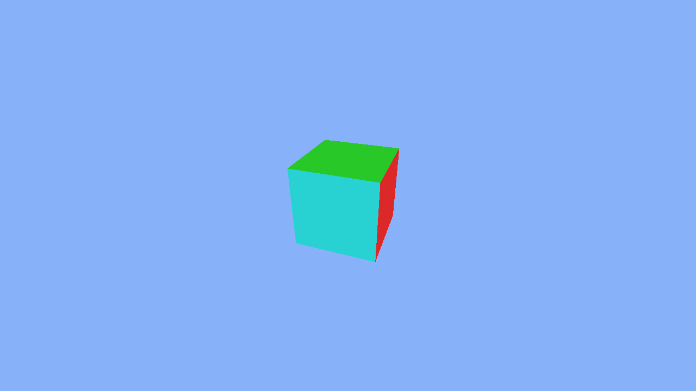
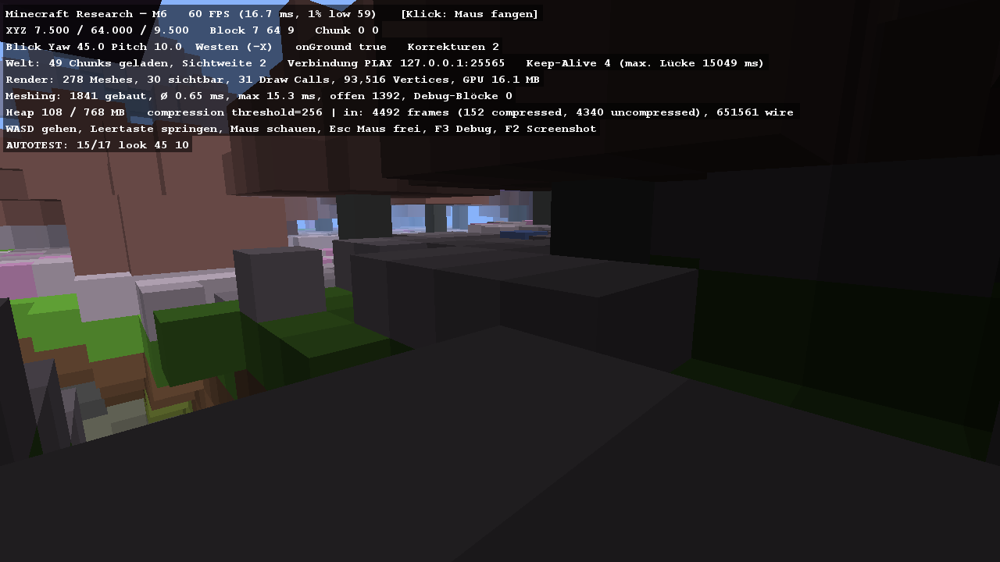
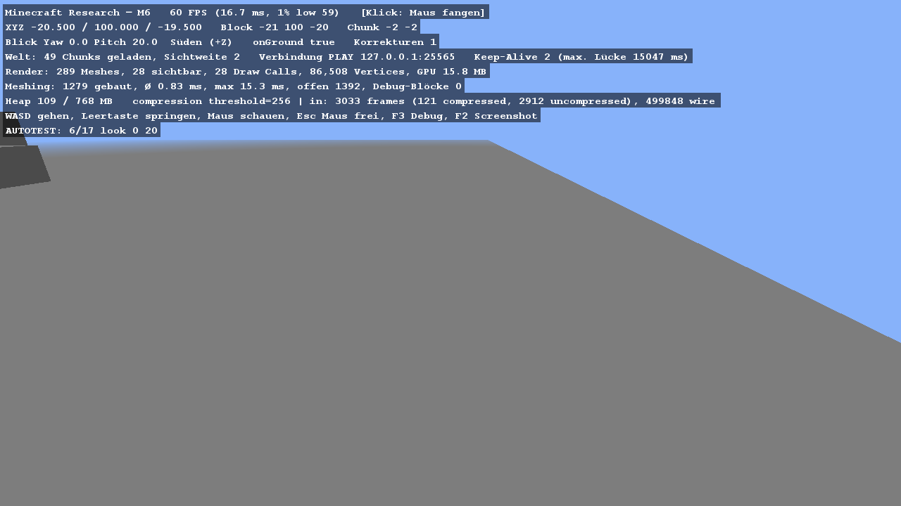

# 26 – Testbericht M6: Grafischer Client

**Datum:** 2026-11-08

**Hardware:** Windows 11, 16 GB RAM, NVIDIA GeForce RTX 3070 (8 GB, Treiber 621.01), OpenGL 3.3 Core.

**Server:** lokaler Vanilla 26.3 auf 127.0.0.1:25565, Threshold 256. Für die Testläufe gilt `difficulty=peaceful`; die Originalwerte stellt `trap` wieder her.

**Rohdaten** (gitignored): `analysis/runtime-logs/m6/`, `m6-geometry/`, `m6-full/`, `m6-disconnect/`, `m6-perf-before/`, `m6-perf/`
- `report.txt`: Messpunkte;
- `verify.txt`: Abgleich Client ↔ Server;
- `memory.txt`, `netmon.txt`;
- Bildschirmfotos.

## 1. Vorgehen

Die Arbeit folgte kleinen, einzeln geprüften Schritten:
1. **Fenster, Shader, Kamera, ein Testwürfel** (`--test-cube`, ohne Server).
2. **Chunk-Geometrie im Farbmodus** (`--colors`) gegen den Server.
3. **Texturen und Blockmodelle** aus den lokalen Ressourcen.
4. **Steuerung, Physik, Netzwerk:** voller Integrationstest, Disconnect, Leistung.

**Automatisierung** (`analysis/tools/m6-run.sh` + Autotest-Skript):
- Ablauf: Speicher-Vorprüfung → Server starten → grafischen Client mit `--autotest` starten → Server stoppen → Konfiguration zurücksetzen.
- Der Autotest benutzt **denselben Eingabeweg** wie Tastatur und Maus: Tastenzustand → `MovementController.setManualInput`, Blickrichtung → `look`. Netzwerk, Physik, Meshing und Zeichnen laufen unverändert.
- **`verify <name>`:** wartet, bis der Spieler steht, notiert die Clientposition, fragt an der Serverkonsole `data get entity ProtoBotGfx Pos` ab und hält danach 2 s still. Das Skript paart beide Werte.

## 2. Ergebnisse je Schritt

### 2.1 Testwürfel (`docs/images/m6/01-test-cube.png`)

**Aufbau:**
- Kamera auf einer Kreisbahn, Aufnahme bei Frame 120, Kamera bei etwa (3,3 / 2,2 / −0,6).
- Seitenfarben: oben grün, Nord rot, Süd blau, West gelb, Ost cyan.

**Ergebnis:**
- Sichtbar sind nur oben (grün), Osten (cyan) und Norden (rot), Norden am rechten Rand. Das entspricht der Kameralage.
- Damit sind Tiefentest, Backface-Culling, Perspektive und die Yaw/Pitch-Konvention bestätigt.
- 228 Frames in 4,0 s mit VSync 60 FPS, 36 Vertices.

### 2.2 Chunk-Geometrie im Farbmodus (`m6-geometry`)

| Bild | |
|---|---|
|  |  |

- 49 Chunks und 278 Sektionsmeshes, 31 Draw Calls, 93 516 Vertices, 60 FPS.
- Meshing Ø 0,65 ms je Sektion, höchstens 15 ms.
- Innere Flächen entfallen; Gelände, Bäume und Höhlenränder sind als Würfel erkennbar.

Gefundener und behobener Fehler: Vormerkungen für ungeladene Nachbarchunks blieben liegen. Die Anzeige „offen 1392“ und das Warten auf alle Meshes liefen deshalb in eine Zeitüberschreitung. Solche Vormerkungen werden jetzt verworfen; „offen“ zählt nur Arbeit in Sichtweite.

### 2.3 Texturen und Modelle

Laden aus dem lokalen 26.3-JAR: 35 723 Zustände in 1,95–2,2 s, 1245 Texturen (Atlas 2048²), 2757 Modelle, **0 Debug-Zustände**.

Im ersten Durchlauf waren es 104 Debug-Zustände (Hängeschilder). Ursache waren zwei Formatneuerungen in 26.3:
- Texturwerte als Objekt `{sprite, force_translucent}`;
- Elementrotation als Euler-Form `{x, y, z, origin}`.

Beides wird jetzt unterstützt. Dazu kam die Verdeckung über das 16×16-Abdeckungsraster, nötig für Treppenrückseiten aus zwei Elementen.

Bildschirmfotos mit Minecraft-Texturen liegen nur unter `analysis/runtime-logs/m6-full/` (nicht in Git):

| Datei | Inhalt |
|---|---|
| `10-course-overview.png` | Teststrecke mit Steinboden, Hindernissen, Halbblock, Treppe |
| `14-after-blockchange.png` | Goldblock, durchscheinendes Glas, Eichentreppe nach `setblock`/`fill` |
| `15-far-away.png` | Gelände bei x = 600 nach dem Teleport (Erde, Gras, Zuckerrohr) |

### 2.4 Integrationstest (`m6-full`, Phase H)

- 125 Autotest-Schritte, **365 s im Spiel**, 21 817 Frames.
- Kein Absturz, kein ungewollter Disconnect, kein Tod.

**Serverseitiger Abgleich** (`verify.txt`):

| Prüfung | Client | Server (`data get … Pos`) | Ergebnis |
|---|---|---|---|
| Gehen geradeaus (W, 1,5 s) | −20,5 / 100 / −16,0280 | −20,5 / 100,0 / −16,02798334640486 | ✓ |
| Sprung im Stand | −20,5 / 100 / −16,0280 | identisch | ✓ landet am Ausgangspunkt |
| Diagonal (W+A, 1 s) | −17,3877 / 100 / −12,9157 | −17,3877016334536 / 100,0 / −12,915684979858458 | ✓ |
| Hindernis (voller Block) | z = −15,3000 | −15,300000011920929 | ✓ Kollision bündig |
| Treppe | y = 103,0, z −12,5963 | 103,0 / −12,596265209622949 | ✓ drei Stufen hoch |
| Zaun | z = −14,9250 | −14,925000011920929 | ✓ Pfosten 6/16 |
| Grube (Fallen) | y = 97,0 | 97,0 | ✓ |
| nach Chunk-Unload/-Reload | −20,5 / 100 / −22,5 | identisch | ✓ |
| Ende des 5-Minuten-Laufs | −17,6951 / 100 / −22,5198 | −17,695087805077737 / 100,0 / −22,51983309698027 | ✓ |

**Weitere Befunde:**
- **Korrekturen:** 8, ausschließlich die 8 Testteleports.
- **Keep-Alive:** 23 beantwortet, größte Lücke 15 059 ms.
- **Blockänderung sichtbar:** Nach `setblock`/`fill` wurden die betroffenen Sektionen neu gebaut. Goldblock, Glas und Treppe sind im Bild.
- **Chunk-Unload/-Reload:**

  | Zeitpunkt | Meshes | GPU-Speicher |
  |---|---|---|
  | vor dem Teleport | 308 | 22,1 MB |
  | bei x = 600 | 195 | 11,6 MB |
  | zurück | 224 | 16,3 MB |

  Die alten Puffer wurden freigegeben (Zähler `deletes`).

Im ersten Durchlauf passten drei Paare nicht zusammen. Die Ursache war ein Messfehler: Die Serverkonsole liest per `tail -f` mit bis zu ~1 s Verzögerung, die nächste Bewegung lief da schon. Behoben durch 2 s Stillstand nach jeder Abfrage.

### 2.5 Disconnect (`m6-disconnect`)

**Ablauf:** Der Server wird mit `stop` beendet, während der grafische Client spielt.

Bildschirmfoto: `analysis/runtime-logs/m6-disconnect/20-disconnected.png` (enthält Minecraft-Texturen, daher nur lokal).

- **Anzeige:** Das Fenster zeigt ein rotes Banner mit dem Grund. Die Welt bleibt sichtbar; es gibt keinen Absturz.
- **Grund:** Je nach Zeitpunkt der Socket-Schließung lautet er `multiplayer.disconnect.server_shutdown` oder `EOFException: End of stream`. Beides wurde beobachtet.
- **Gefundener Fehler:** `ClientSession.playing()` blieb nach einer Trennung durch den Server `true`. Der Debug-Text zeigte weiter „PLAY“, und das Warten auf die Trennung lief in eine Zeitüberschreitung.
- **Behebung:** `playing()` berücksichtigt jetzt die Trennung durch den Server und das Verbindungsende. Nachtest: Die Trennung wird nach 1,6 s erkannt.

## 3. Erfolgskriterien (Phase H)

| Kriterium | Ergebnis |
|---|---|
| 1. Eigenes Fenster öffnet sich | ✓ GLFW/OpenGL 3.3 Core, in jedem Lauf |
| 2. Verbindung mit localhost | ✓ Login, Configuration, Play; `LoopbackGuard`; netmon: 0 externe Verbindungen |
| 3. Chunks als 3D-Geometrie sichtbar | ✓ Farbmodus und texturiert, Bildschirmfotos |
| 4. Orientieren und Bewegen mit WASD und Maus | **teilweise:** Bewegung und Blickrichtung über denselben Eingabeweg automatisiert geprüft (✓). Echte Tastatur- und Mauseingaben **nicht automatisiert getestet** (§5). |
| 5. Springen, Fallen, getestete Kollisionen | ✓ Sprung, Grube, Hindernis, Treppe, Zaun serverbestätigt |
| 6. Server übernimmt die erreichten Positionen | ✓ 9/9 Abfragen identisch, keine Korrektur außer Teleports |
| 7. Blockänderungen werden sichtbar | ✓ (Abschnitt 2.4, Bild 14) |
| 8. Chunk-Unload und -Reload | ✓ Meshes und GPU-Speicher sinken und steigen wieder; Welt nach Rückkehr wieder vollständig |
| 9. 5 Minuten Spielbetrieb ohne Absturz oder Disconnect | ✓ 365 s mit Bewegung; Speicher stabil (Heap 93–230 MB) |
| 10. Alle bestehenden Tests grün | ✓ siehe §6 |

## 4. Messwerte

| Größe | Wert |
|---|---|
| FPS mit VSync | 60 (1%-Low 57–59 im eingeschwungenen Zustand; beim ersten Laden 15–18) |
| FPS ohne VSync, Teststrecke | ~3830 (1%-Low ~1750), 183 474 Vertices, 34 Draw Calls |
| FPS ohne VSync, Gelände | ~2840 (1%-Low ~910), 221 412 Vertices |
| niedrigster FPS-Wert nach der Ladephase (ohne VSync) | 243 |
| Draw Calls | 13–54 (eine Sektion = höchstens 2: undurchsichtig + durchscheinend) |
| Meshing je Sektion | Ø 0,4–1,6 ms, höchstens 55 ms (Spitzen beim ersten Laden, 2 Threads) |
| Mesh-Neubauten in 6 Minuten | ~6300, hauptsächlich durch `light_update` (ganze Chunks) |
| GPU-Speicher | 15–28 MB Vertexdaten + 16 MB Atlas |
| Java-Heap des Clients | 93–230 MB von 768 MB |
| Projekt-Working-Set gesamt (Server + Client + Gradle) | 1,4–1,8 GB |
| Ressourcen laden | 1,95–2,2 s |

**Leistungsfehler gefunden und behoben:**
- Das Overlay wurde mit dem FPS-Wert in jedem Frame neu gezeichnet und hochgeladen (Java2D + Texturupload).
- Gemessen vorher ~280 FPS ohne VSync (`m6-perf-before`), nachher ~3830 FPS (`m6-perf`) mit Begrenzung auf 4 Aktualisierungen pro Sekunde.

## 5. Nicht oder nur eingeschränkt getestet

- **Echte Tastatur und Maus** (WASD-Tasten, Mausdrehung, Esc, F3, F2, Linksklick zum Fangen):
  - Der Code ist vorhanden und nutzt dieselben Wege wie der Autotest.
  - Ich konnte im Fenster aber nicht selbst tippen oder die Maus bewegen.
  - **Bitte einmal von Hand prüfen.**
- **Start aus IntelliJ:**
  - Die Startkonfiguration „Minecraft Research – Graphical Client“ ist angelegt; ihr XML ist gültig.
  - Sie startet denselben Gradle-Task `runGraphical`, der in allen Läufen benutzt wurde.
  - Der Klick in IntelliJ selbst wurde nicht ausgeführt; die IntelliJ-Anbindung war in dieser Sitzung nicht verbunden.
- **Fenstergrößenänderung:** Rückruf und Viewport-Anpassung sind implementiert, aber nicht automatisiert getestet.
- **Sichtweiten > 2:** nicht gemessen; erlaubt sind bis 8.
- **Darstellungsgrenzen** (docs/24 §9): Block-Entities, Entities, Licht, Biomtönung, Animationen.
- **Euler-Elementrotation:** Die Reihenfolge ist nicht gegen die Quelle geprüft; betroffen sind Hängeschilder.

## 6. Regression aller Meilensteine

`bash analysis/tools/m5-run.sh 256` nach allen M6-Änderungen:

| Bereich | Ergebnis |
|---|---|
| JUnit | **241/241** (236 Unit + 5 Integration) |
| M1 | Status/Login/Configuration/71 s Play/Keep-Alive/Disconnect ✓ |
| M2/M3 | Bewegung und Rotation serverseitig, Kompressionszähler ✓; M2-Terminaltest ✓ |
| M4 | Blockabgleich 657/657, 81/81, 81/81 ✓; M4-Terminaltest ✓ |
| M5 | Physik 896/896 Ticks bitgleich mit dem Vanilla-Client, 0 Korrekturen ✓; M5-Terminaltest ✓ |
| Fabric-Client | Referenzlauf ✓ |

**Unit-Tests:** 236; neu 6 `ResourceModelsTest` und 8 `ViewTest`.

**Nach allen Läufen:**
- Alle Projektprozesse sind beendet (Server, Client, Monitore, `tail`); Port 25565 ist frei.
- `server.properties` steht wieder auf dem Original (`difficulty=easy`, `network-compression-threshold=-1`).
- Die Original-JARs sind unverändert.
- Es wurden keine Mojang-Ressourcen kopiert; die Bilder in `docs/images/m6/` enthalten keine Minecraft-Texturen.

## 7. Empfehlung für M7

1. **Handtest der Steuerung** (§5) und gegebenenfalls Feineinstellung der Mausempfindlichkeit.
2. **Bildqualität:** Umgebungsverdeckung, weiches Licht, Biomtönung aus den Chunk-Biomen (bereits in M4 dekodiert), animierte Texturen, Mipmaps.
3. **Effizienz:** Licht-Updates nur für betroffene Sektionen neu vermeschen statt ganzer Chunks; größere Sichtweiten messen.
4. **Interaktion:** Blöcke anvisieren (Raycast gegen die Kollisionsformen aus M5), abbauen und setzen; Chat; Fadenkreuz.
5. **Block-Entities und Entities:** Truhen, Schilder, Spieler, Mobs.
